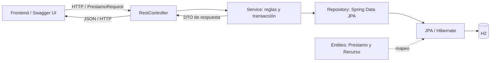

# Spring Boot Learning Lab — decisiones finales de diseño

Este documento describe la arquitectura y la experiencia **implementadas**. Complementa las instrucciones operativas de [README.md](README.md) y toma como referencia la pauta de [MATERIAL_EVALUACION.md](docs/MATERIAL_EVALUACION.md). La pauta contiene propuestas y un diagnóstico inicial del splash; las decisiones finales son las reflejadas por el código actual.

## 1. Propósito y alcance

El sistema permite comprender Spring Boot mediante el caso de préstamos de libros y equipos del instituto. La secuencia didáctica es: **leer → interactuar → observar → recibir explicación → comprobar → reflexionar**.

Se mantiene un backend pequeño y demostrativo. El proyecto no es un sistema de inventario completo, no implementa autenticación y no ejecuta Java escrito por el estudiante. Las simulaciones se distinguen de las operaciones que consultan o modifican H2.

Las decisiones de este documento no implican agregar funcionalidades ni rediseñar los bloques ya aprobados.

## 2. Estructura general

| Área | Implementación |
|---|---|
| Entrada y servidor | `SpringBootLearningLabApplication`, Java 21 y Spring Boot 3.5.16, con Tomcat embebido |
| Vista inicial | `VistaController` devuelve `templates/index.html` con Thymeleaf |
| API | `PrestamoController` y `RecursoController` |
| Reglas | `PrestamoService` y `RecursoService`, con inyección por constructor |
| Persistencia | Repositories Spring Data JPA, entidades `Prestamo` y `Recurso`, Hibernate y H2 |
| Contratos HTTP | Records de entrada/salida en `dto` |
| Errores | Excepciones de negocio y `GlobalExceptionHandler` |
| Inicialización | `DatosInicialesConfig`, condicionado a que no existan recursos |
| Frontend | [index.html](src/main/resources/templates/index.html), [app.js](src/main/resources/static/js/app.js) y [app.css](src/main/resources/static/css/app.css) |

La aplicación web y la API viven en el mismo proceso y origen. El frontend usa Fetch; no se añadió un frontend separado ni un router de rutas HTTP para cada módulo.

### Flujo real de una operación



Tomcat y DispatcherServlet participan en la entrada HTTP de Spring MVC. El gráfico resume las responsabilidades de aplicación. Una Entity es el modelo persistente; no recibe peticiones ni constituye una llamada HTTP adicional entre Repository y H2.

La interfaz enseña dos grupos separados:

- **Flujo principal:** Controller → Service → Repository → Entity.
- **Paquetes de apoyo:** DTO, Exception y Config, sin flechas que los presenten como pasos sucesivos.

Las siete opciones siguen siendo interactivas y comparten el panel de explicación. La relación pedagógica no reemplaza el flujo técnico anterior.

### Contratos y responsabilidades

`PrestamoRequest` contiene nombre, correo y recursoId. `PrestamoResponse` expone los datos del préstamo y del recurso asociado; `RecursoResponse` informa disponibilidad. No se devuelven las Entities directamente desde la API.

Los repositories son interfaces que extienden `JpaRepository`; Spring Data crea su implementación. Los ejemplos de `@Repository` se enseñan como concepto, sin atribuir una anotación explícita que no está en esas interfaces.

Los ejemplos `Alumno` y `AlumnoResponse`, incluido el riesgo de exponer `password`, son educativos. No agregan un modelo de alumnos al backend.

## 3. Persistencia y reglas de negocio

### Modelo almacenado

- `RECURSO`: ID, NOMBRE, TIPO y DISPONIBLE.
- `PRESTAMO`: ID, NOMBRE_ALUMNO, CORREO_ALUMNO, FECHA_PRESTAMO, ESTADO y RECURSO_ID.
- IDs generados con `IDENTITY`.
- Relación `Prestamo.recurso` ManyToOne, EAGER y no opcional.
- Nombre y tipo de recurso incluidos en el DTO se obtienen de la relación, no de columnas duplicadas en PRESTAMO.

H2 es persistente en archivo, con `AUTO_SERVER=TRUE` y `ddl-auto=update` en la configuración base. La base no se restablece al abrir una vista ni al reiniciar Spring Boot. La carga inicial agrega cuatro recursos solo si la tabla está vacía; no devuelve préstamos existentes.

### Registro

POST `/api/prestamos` valida el DTO, busca el recurso, verifica disponibilidad, lo marca ocupado y guarda un préstamo ACTIVO con fecha de creación. `PrestamoService.registrar` ejecuta la operación con `@Transactional` y devuelve un DTO con `201 Created`.

### Devolución controlada

PATCH `/api/prestamos/{id}/devolucion` no necesita body. El Controller valida el ID y delega al Service. Dentro de una transacción:

1. `buscarParaDevolucion` obtiene el préstamo con `PESSIMISTIC_WRITE`.
2. Si no existe, se responde 404.
3. Si su estado no es ACTIVO, se responde 409 antes de modificar disponibilidad.
4. `marcarDevuelto()` cambia el estado a DEVUELTO.
5. El recurso asociado pasa a disponible; JPA sincroniza ese cambio en la misma transacción.
6. Se guarda el préstamo y se devuelve `PrestamoResponse` con 200.

Se conservan ID, fecha, alumno, correo y recurso. No se borra ni recrea el préstamo. El bloqueo protege devoluciones concurrentes del mismo registro y la comprobación impide que una devolución repetida libere un recurso prestado después. No equivale a un bloqueo añadido al alta de préstamos ni a una restricción única global de préstamos activos.

### Validaciones y errores

El DTO real usa `@NotBlank` y `@Size(min = 3, max = 80)` en nombre, `@NotBlank` y `@Email` en correo, y `@NotNull` en recursoId. La devolución utiliza `@Positive` en el ID de ruta.

`@Min(1)` permanece en actividades educativas. Esas comprobaciones locales no cambian el DTO ni sustituyen la validación real con `@Valid`.

`GlobalExceptionHandler` mantiene las respuestas 400, 404 y 409, incluida la validación del ID de devolución. Los errores del DTO devuelven el mapa de campos. La interfaz muestra el HTTP y JSON real y no presenta una falla de red como confirmación de creación o devolución.

## 4. Entrada, navegación y conservación de estado

### Splash y portada

Son pantallas distintas:

1. Splash simple con `{ }`, nombre y “Aprendiendo Spring Boot desde adentro”.
2. Entrada de 700 ms, permanencia legible de 3 s y salida de 1000 ms.
3. El splash se oculta completamente antes del fade-in de 700 ms de la portada.
4. La portada conserva introducción, referencia a Desarrollo de Software Web II, chips y Comenzar aprendizaje.
5. Solo ese botón abre la ruta de aprendizaje.

El splash se reproduce en cada carga completa, aunque existan módulos completados. No usa almacenamiento para saltarse. Con `prefers-reduced-motion` se eliminan los fades y se conserva la pausa central de lectura.

### Vistas y accesos

`showView` cambia la vista activa sin reconstruir sus componentes. El encabezado compartido ofrece Laboratorio, Vocabulario, Fuentes y Swagger; la marca vuelve al dashboard.

Los módulos, las dos páginas del Módulo 3 y las dos áreas del Laboratorio conservan valores y desplegables al navegar dentro de la misma carga. Una recarga inicia nuevas actividades, con la excepción del progreso guardado.

Swagger y H2 Console abren interfaces técnicas separadas en otra pestaña; no utilizan el encabezado visual propio del laboratorio educativo.

### Progreso persistente

Un único `Set completed` contiene módulos completados. El listener compartido de `[data-complete]` agrega el ID, actualiza la interfaz y guarda el array.

- Clave: `springBootLearningLab.completedModules`.
- IDs permitidos: `module1`, `module2`, `module3`, `module4`.
- Cada módulo representa 25 %; Módulo 3 cuenta una sola vez.
- La carga filtra IDs desconocidos y elimina duplicados mediante el Set.
- `updateProgress` centraliza contador, porcentaje, clase visual, texto y bloqueo de botones, y mensaje final.
- Si se bloquea localStorage o su contenido está dañado, la aplicación continúa funcionando con progreso de sesión.
- El alcance es el perfil/origen del navegador: no se sincroniza con H2 ni entre dispositivos.

No se almacenan respuestas, formularios, navegación, Profiles, simulaciones ni datos reales. Laboratorio, Vocabulario, Fuentes y Swagger no suman progreso. Repetir los cuestionarios tampoco elimina módulos completados. El marcado de módulos es manual; no representa una nota persistente del cuestionario.

## 5. Identidad visual y accesibilidad

Se conserva fondo petróleo `#102F3A`, superficies blancas o blanco cálido, títulos petróleo, textos secundarios gris petróleo y bloques oscuros monoespaciados. Las tarjetas claras se distinguen mediante bordes discretos, radios y sombras suaves.

La marca compartida mantiene su geometría: `{ }` verde `#9CDD70` sobre `#173F49` con borde suave; Spring Boot blanco y Learning Lab `#BED0D5`. Hover y foco cambian contraste sin agrandar el logo.

Los cuatro módulos comparten identidad. La diferenciación de color del dashboard está **en los números**, no en tarjetas completas:

| Número | Acento |
|---|---|
| 01 | Verde `#6DB33F` |
| 02 | Petróleo medio `#357A8A` |
| 03 | Violeta `#7657A6` |
| 04 | Coral `#D96F51` |

Vocabulario usa violeta; Laboratorio, coral; Fuentes, verde; Swagger, petróleo medio. Se emplean variantes oscuras donde el texto compacto necesita mayor contraste. Por ejemplo, el botón activo Ver resultado final del Laboratorio utiliza `#437B28` con texto blanco y `#376720` en hover/foco; `#6DB33F` queda como detalle de borde. El deshabilitado tiene tratamiento propio.

Se utilizan botones nativos, labels, fieldsets, details/summary, tablas con encabezados, mensajes de estado y foco visible. La interacción no depende solo del color o de drag-and-drop. Se mantienen tamaños táctiles, navegación con Tab y activación nativa con Enter/Espacio cuando corresponde.

### Responsive

- Dashboard: cuadrícula 2 × 2 en escritorio y una columna en móvil.
- Módulo 2: Properties/YAML y Profiles apilados a todo el ancho.
- Módulo 3: dos columnas independientes en escritorio; una columna a partir de su breakpoint de 1000 px.
- Docker: fila completa después de ambas columnas, incluso cuando otra tarjeta se expande.
- Vocabulario: dos columnas de categorías en escritorio y una en móvil.
- Flujos largos se adaptan o pasan a vertical; los ejemplos se contienen dentro de las tarjetas.
- Tablas de datos reales conservan todas sus columnas con scroll interno, sin forzar scroll horizontal de la página.
- Las reglas de movimiento reducido eliminan transiciones decorativas y mantienen el contenido consultable.

Los breakpoints y excepciones específicos se conservan en `app.css`; no hay un diseño diferente por cada página que utilice la marca.

## 6. Organización de los módulos

### Módulo 1 — Fase 1

La simulación de arranque enseña siete etapas, con avance cada 1800 ms, explicación, “Por qué importa” y ejemplo. `startupReached` conserva el avance real; la selección consultada se guarda aparte.

En pausa se habilitan las siete etapas, incluidas las futuras. Consultar una no la marca ejecutada. Reanudar muestra el último paso realmente alcanzado y avanza desde ahí. Se mantienen las diferencias visuales entre ejecutado, consultado y pendiente, así como Pausar, Reanudar y Repetir.

El recorrido MVC muestra permanentemente sus ocho etapas y avanza un paso por clic. Los ejemplos Controller/RestController y la comprobación breve siguen disponibles. Estas simulaciones no arrancan otro servidor ni crean préstamos.

### Módulo 2 — Fase 2

Maven tiene cuatro etapas educativas y cuatro dependencias; la selección utiliza un panel compartido. Se distingue cómo trabaja Maven de qué aporta cada dependencia.

Properties/YAML ocupa todo el ancho y Profiles aparece debajo, también a todo el ancho. Se conservan puerto, checkbox SQL, formato equivalente, seis propiedades y sus explicaciones. Cambiar estos controles no escribe configuración real. DEV/PROD y el acordeón de activación son didácticos.

El bloque Backend real mantiene sus cajones de capas interactivos, la indicación para explorarlos y el formulario conectado a la API. El selector tiene optgroups nativos: DISPONIBLES primero y PRESTADOS después. `✓` y `✕` complementan el estado `disabled`.

El ciclo deliberado es:

```text
Disponible → POST → 201 Created → Prestado
           → devolución explícita → 200 OK → DEVUELTO → Disponible
```

El botón de devolución aparece inmediatamente debajo de Registrar y solo usa el ID confirmado del último POST exitoso de esa carga. No usa localStorage, fechas o IDs máximos para elegir un préstamo.

Tras devolver, se oculta el botón, se recargan recursos y se reinician formulario y paneles de petición/respuesta. Una confirmación junto al formulario conserva el resultado educativo de la devolución. El historial real no se limpia.

### Módulo 3 — Fase 3, dos páginas internas

**Buenas prácticas:** organización en flujo principal y paquetes de apoyo; Entity/DTO; validaciones; errores y códigos HTTP; seguridad y variables de entorno.

**Tendencias y herramientas:** Spring Boot 3.x y Java 21; Records; Virtual Threads; Actuator; OpenAPI/Swagger; Docker.

Las páginas solo ocultan/muestran contenedores existentes. No clonan ni reconstruyen formularios; conservan selección Entity/DTO, valores, feedback, código HTTP, seguridad, Records, simulación de hilos, respuesta de Actuator, ejemplos Swagger y Dockerfile. Completar el módulo está al final de la segunda página.

Se mantienen columnas independientes para evitar filas cuya altura dependa de la tarjeta vecina. Docker es hijo directo de la cuadrícula, con `grid-column: 1 / -1`. Su contenido, flujo de cinco etapas, panel compartido y Dockerfile no se alteran al darle ancho completo.

### Módulo 4 — Fase 4

Cinco preguntas, una visible a la vez, elección explícita y botón Responder. Cada comprobación muestra resultado y explicación; después se habilita el siguiente paso. El resultado incluye X/5, porcentaje, orientación y reflexión.

Repetir reinicia únicamente el cuestionario. La acción de completar el módulo y la restauración desde localStorage mantienen el progreso global independiente de las respuestas.

## 7. Tendencias y herramientas implementadas

### Records y Virtual Threads

Los DTOs reales son Records. La comparación educativa de clase tradicional frente a Record explica constructor, accesores, equals, hashCode y toString sin reemplazar los DTOs del backend.

Virtual Threads muestra dos columnas explícitas: solicitud, espera BD/HTTP/archivo y efecto sobre el hilo de plataforma. La conclusión explica su utilidad para muchas esperas concurrentes; no promete acelerar una tarea individual ni cálculos intensivos de CPU.

Se conserva Java 21, la configuración real `spring.threads.virtual.enabled=true`, la simulación manual de solicitudes y la aclaración sobre I/O compatible y fijación del hilo portador. No se presentan tiempos simulados como benchmark.

### Actuator

La aplicación expone health e info. El botón inicia cerrado:

- Abrir ejecuta GET `/actuator/health` y muestra petición, respuesta completa y explicación.
- Mientras carga se impiden consultas duplicadas.
- Se evalúan HTTP y `status` reales; no se sustituye una falla por UP.
- Cerrar oculta el bloque y restaura el texto inicial **sin nueva llamada**.
- La respuesta permanece en el DOM y volver a abrir realiza una nueva consulta.

El JSON tiene scroll interno para no expandir excesivamente la tarjeta, sin recortar datos de la respuesta.

### OpenAPI / Swagger

springdoc genera `/v3/api-docs` y sirve Swagger UI mediante `/swagger-ui.html`. El Módulo 3 conserva el ejemplo de POST con Request y Response esperada; ese fragmento está rotulado como ilustrativo.

La guía explica GET, POST, PATCH, Try it out, Execute, Request body, Response body y códigos 200/201/400/404/409. La advertencia sobre escrituras reales en H2 permanece visible. Los códigos se consultan en un desplegable para compactar. El acceso Abrir Swagger conserva su ruta y abre otra pestaña.

No existe todavía un área independiente de Pruebas de API dentro del Laboratorio de práctica; no debe documentarse como implementada.

### Docker

El Dockerfile real usa Temurin 21 JRE y copia el JAR ya compilado. El flujo educativo es Proyecto Spring Boot → Maven genera JAR → Docker crea imagen → Se inicia contenedor → Aplicación disponible.

Cada etapa actualiza el mismo panel. El Dockerfile se despliega sin sustituir contenido. La tarjeta es de ancho completo; el flujo es horizontal en escritorio y vertical en móvil. La imagen no incluye Maven ni una base externa. La persistencia entre contenedores requiere un volumen para `/app/data`, como se describe en README.

## 8. Configuración real y seguridad educativa

Solo existen `application.properties`, `application-dev.properties` y `application-prod.properties`. YAML es una representación de la interfaz.

- Base: H2 en archivo `learninglab`, puerto 8080, SQL visible, ddl-auto update.
- DEV: H2 en archivo `learninglab-dev` y opciones de desarrollo.
- PROD: URL, usuario y contraseña mediante `DB_URL`, `DB_USERNAME` y `DB_PASSWORD`; ddl-auto validate y detalles de salud never.

El perfil productivo conserva el driver H2 y la consola habilitada heredados de la base. No configura automáticamente otro motor, autenticación, secretos administrados ni un despliegue productivo. La explicación de variables de entorno no equivale a implementar esas capacidades.

El formulario educativo de validación y los ejemplos con `@Min` no cambian la API. Las advertencias de contraseña usan valores ficticios y los resultados distinguen riesgo de práctica correcta.

## 9. Páginas de apoyo

### Laboratorio de práctica

Las áreas Práctica de código y Datos en H2 ocultan/muestran sus propios contenedores. Conservan estado durante la carga; no afectan el Set de módulos.

Los cinco desafíos son: escribir `@RestController` con apoyo visual, ordenar capas con Subir/Bajar, completar DTO en textarea, elegir PostMapping y detectar exposición de datos internos de una Entity. Se comprueba antes de comparar con una solución. El análisis del DTO revisa anotaciones junto a campos y descarta coincidencias en comentarios/cadenas; no compila ni ejecuta código.

El resultado usa la última comprobación por desafío. Repetir limpia solo esos ejercicios y no reinicia el área de datos ni los módulos completados.

Datos en H2 identifica ejemplos frente a datos reales. El recorrido de seis etapas no hace escrituras. La tabla consulta únicamente GET `/api/prestamos` por acción explícita, permite actualizar y distingue carga, éxito, vacío y error. Muestra campos del DTO sin interpretarlos como columnas duplicadas de PRESTAMO. La estructura, el SELECT representativo y los conceptos de tabla/fila/columna/ID/clave primaria se despliegan de forma compacta. H2 Console es un acceso secundario.

### Vocabulario técnico

Se conservan 82 términos, siete categorías y todos sus significados, utilidades, ejemplos y palabras relacionadas. Las categorías son acordeones nativos; solo uno queda abierto. Los términos están dentro del cajón y abren un único dialog nativo.

El modal mantiene Anterior, Siguiente, Cerrar, Escape y ciclo de foco con Tab. Cerrar deja la categoría abierta. Buscar y Enter ejecutan la búsqueda local; escribir no filtra. Una coincidencia exacta abre categoría y modal; múltiples resultados se muestran compactos y una búsqueda vacía de resultados mantiene las categorías visibles.

`#vocabulary/dto` abre Arquitectura y DTO. En una carga completa se respeta primero el splash y la portada. No se utiliza el hash para completar módulos.

### Fuentes

Cuatro acordeones conservan siete referencias existentes: Spring Boot/arquitectura, Java/tendencias, herramientas/documentación y bibliografía complementaria. Las fuentes externas mantienen sus URLs; no se atribuyen nuevas referencias ni se cambian por el rediseño.

## 10. Decisiones conservadas y comprobación

Se mantienen como contrato de la versión final:

| Decisión aprobada | Criterio para conservarla |
|---|---|
| Separación de splash y portada | No convertir la portada en splash ni saltarse la lectura usando almacenamiento |
| Cuatro módulos | No dividir Módulo 3 en dos módulos ni sumar apoyo al porcentaje |
| Identidad petróleo y superficies claras | No recolorear tarjetas completas por módulo ni variar el brand entre vistas |
| Configuración didáctica | No escribir archivos o activar perfiles desde los controles |
| Historial de préstamos | No borrar filas ni devolver automáticamente tras el POST |
| Estado de actividades | No reconstruir componentes para navegar entre páginas o áreas |
| Docker a ancho completo | Mantener columnas independientes de los demás contenidos |
| Ejemplos frente a backend real | No inventar registros, respuestas UP o llamadas ejecutadas |
| Progreso local | Persistir únicamente IDs de módulos, sin respuestas ni formularios |
| Alcance educativo | No añadir CRUD general, IDE, compilador o áreas de API no implementadas |

La suite incluida tiene una prueba de contexto y cinco de integración de devolución con MockMvc/JPA. Cubre persistencia e integridad de la fecha, reglas de registro, IDs/errores, devolución repetida tras otro préstamo y devoluciones simultáneas. README proporciona un comando que mantiene las pruebas en memoria.

La comprobación de interfaz contempla escritorio/móvil, teclado, foco, apertura/cierre, conservación de estado y distinción de datos reales. Los scripts de verificación de navegador usados durante el desarrollo no constituyen una suite E2E versionada dentro del proyecto.

Para cambios posteriores, contrastar primero el código con estos acuerdos. Las fuentes se editan en `src/`; `target/` es salida generada. Una plantilla Thymeleaf conservada por la instancia o recursos desactualizados deben diagnosticarse antes de introducir reglas visuales redundantes.
